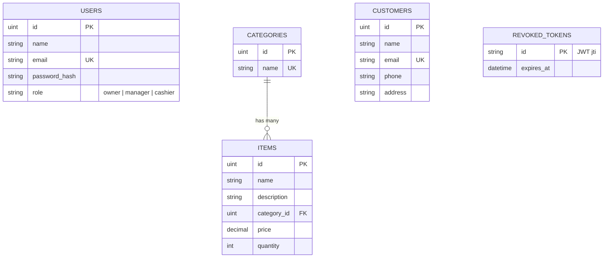

# Ice Cream Shop API (Go + Fiber + MySQL)

Backend for an ice cream shop: JWT authentication, role-based access control (**Owner / Manager / Cashier**), and CRUD APIs for **inventory items** and **customers**.

**Stack:** Go 1.21+, Fiber v2, GORM + MySQL 8, JWT (HS256), bcrypt, go-playground/validator.

## Table of contents

1. [Prerequisites](#prerequisites)
2. [Quick start](#quick-start)
3. [Configuration](#configuration)
4. [Running the tests](#running-the-tests)
5. [Seed users](#seed-users)
6. [Role permissions](#role-permissions)
7. [API endpoints](#api-endpoints)
8. [Database design / ER diagram](#database-design--er-diagram)
9. [Project structure](#project-structure)
10. [Postman](#postman)

## Prerequisites

- [Go 1.21+](https://go.dev/dl/)
- MySQL 8 (local install, XAMPP, or Docker)
- Git

## Quick start

### 1. Clone

```bash
git clone https://github.com/MarioShehan22/ice-cream-api.git
cd ice-cream-api
```

### 2. Set up the database (pick one)

**Option A - SQL script (works with any MySQL)**

`icecream.sql` creates the `icecream` database, all tables, and the seed data.

```bash
mysql -u <user> -p < icecream.sql
```

Or open `icecream.sql` in MySQL Workbench.


Starts MySQL 8 with databases `icecream` and `icecream_test`, user `icecream`, password `icecream`, on port 3306. The API creates the tables itself on startup (auto-migration) and seeds data when `SEED_ON_START=true`.

> If port 3306 is already used by a local MySQL/XAMPP, stop it or change the port mapping in `docker-compose.yml` and in `DATABASE_DSN`.

### 3. Configure

```bash
cp .env.example .env          # Windows: copy .env.example .env
```

Edit `.env` and set `DATABASE_DSN` for your MySQL user and password, and a long random `JWT_SECRET` (see [Configuration](#configuration)).

### 4. Run

```bash
go mod tidy
go run ./cmd/server
```

The API listens on `http://localhost:8080`. Check it: `GET http://localhost:8080/api/health`.

On startup the app connects to MySQL (retrying for ~30 s while the database boots), runs migrations, and, if `SEED_ON_START=true`, inserts any missing seed data (idempotent - it never duplicates rows).

## Configuration

All settings come from environment variables or a `.env` file (see `.env.example`).

| Variable            | Default                         | Description |
|---------------------|---------------------------------|-------------|
| `PORT`              | `8080`                          | HTTP port |
| `DATABASE_DSN`      | local `icecream` database       | MySQL DSN: `user:password@tcp(host:3306)/dbname?charset=utf8mb4&parseTime=True&loc=Local` |
| `JWT_SECRET`        | *(required)*                    | Signing key, at least 16 characters |
| `JWT_TTL_HOURS`     | `24`                            | Token lifetime in hours |
| `SEED_ON_START`     | `true`                          | Insert default users, categories, items and customers on startup |
| `TEST_DATABASE_DSN` | *(unset)*                       | Only for `go test` - see below |

Example `.env`:

```env
PORT=8080
DATABASE_DSN=root:yourpassword@tcp(127.0.0.1:3306)/icecream?charset=utf8mb4&parseTime=True&loc=Local
JWT_SECRET=change-me-to-a-long-random-string
JWT_TTL_HOURS=24
SEED_ON_START=true
```

> Put comments on their own line in `.env`. A trailing comment on a value line becomes part of the value.
> `.env` is git-ignored - never commit real credentials.

## Running the tests

The JWT unit tests always run. The API tests (login, role matrix, CRUD, search, validation) run against a real MySQL database and are **skipped unless `TEST_DATABASE_DSN` is set**.

The tests **drop and recreate every table** in that database, so use a separate one. The database name must contain `test` (enforced by the test setup).

```sql
CREATE DATABASE IF NOT EXISTS icecream_test CHARACTER SET utf8mb4 COLLATE utf8mb4_unicode_ci;
```

```bash
# macOS / Linux
export TEST_DATABASE_DSN='<user>:<password>@tcp(127.0.0.1:3306)/icecream_test?charset=utf8mb4&parseTime=True&loc=Local'

# Windows PowerShell
$env:TEST_DATABASE_DSN='<user>:<password>@tcp(127.0.0.1:3306)/icecream_test?charset=utf8mb4&parseTime=True&loc=Local'

go test ./... -v
```

## Seed users

| Role    | Email                   | Password     |
|---------|-------------------------|--------------|
| Owner   | owner@icecream.test     | Owner@123    |
| Manager | manager@icecream.test   | Manager@123  |
| Cashier | cashier@icecream.test   | Cashier@123  |
| Owner   | shehan@gmail.com        | Shehan@123   |

Passwords are stored as bcrypt hashes. There is no registration endpoint (per the assessment brief); users are created by the seed data.

The seed data also contains the categories (Chocolate, Vanilla, Strawberry), 6 inventory items, and 3 customers. The `shehan@gmail.com` account is added by `icecream.sql`.

## Role permissions

| Action             | Owner | Manager | Cashier |
|--------------------|:-----:|:-------:|:-------:|
| Items - view       | yes   | yes     | yes     |
| Items - add        | yes   | yes     | **no**  |
| Items - edit       | yes   | yes     | yes     |
| Items - delete     | yes   | **no**  | **no**  |
| Customers - view   | yes   | yes     | yes     |
| Customers - add    | yes   | yes     | yes     |
| Customers - edit   | yes   | yes     | yes     |
| Customers - delete | yes   | **no**  | **no**  |

Enforced server-side in `internal/server/server.go` via `middleware.RequireRoles(...)`. Unauthenticated requests get `401`; authenticated but forbidden requests get `403`.

## API endpoints

Send the token on every protected request: `Authorization: Bearer <token>`.

| Method      | Path                  | Access                | Notes |
|-------------|-----------------------|-----------------------|-------|
| GET         | `/api/health`         | public                | health check |
| POST        | `/api/auth/login`     | public                | `{ "email", "password" }` returns a JWT (rate limited) |
| POST        | `/api/auth/logout`    | any logged-in user    | revokes the current token |
| GET         | `/api/auth/me`        | any logged-in user    | current user |
| GET         | `/api/categories`     | any logged-in user    | flavours (read-only), use for `category_id` |
| GET         | `/api/items`          | all roles             | `?search=<name>&category_id=<id>&page=1&limit=20` |
| GET         | `/api/items/{id}`     | all roles             | |
| POST        | `/api/items`          | owner, manager        | |
| PUT / PATCH | `/api/items/{id}`     | all roles             | partial update - only the fields you send change |
| DELETE      | `/api/items/{id}`     | owner                 | |
| GET         | `/api/customers`      | all roles             | `?search=<name/email/phone>&page=1&limit=20` |
| GET         | `/api/customers/{id}` | all roles             | |
| POST        | `/api/customers`      | all roles             | |
| PUT / PATCH | `/api/customers/{id}` | all roles             | partial update |
| DELETE      | `/api/customers/{id}` | owner                 | |

### Request bodies

```jsonc
// POST /api/items   (PUT/PATCH accept any subset of these fields)
{ "name": "Mint Chip", "description": "Mint with chocolate chips", "category_id": 1, "price": 3.50, "quantity": 20 }

// POST /api/customers   (PUT/PATCH accept any subset of these fields)
{ "name": "Chamara Wijesinghe", "email": "chamara@example.com", "phone": "0765551234", "address": "23 Galle Road, Colombo" }
```

### Response shape

```jsonc
// success
{ "data": { ... } }
{ "data": [ ... ], "meta": { "page": 1, "limit": 20, "total": 6, "total_pages": 1 } }

// error
{ "error": { "message": "validation failed", "details": { "price": "must be greater than or equal to 0" } } }
```

Status codes: `200`, `201`, `204` (delete), `400` (bad id / malformed JSON), `401`, `403`, `404`, `409` (duplicate customer email), `422` (validation), `429` (login rate limit).

### Example

```bash
TOKEN=$(curl -s -X POST localhost:8080/api/auth/login \
  -H 'Content-Type: application/json' \
  -d '{"email":"owner@icecream.test","password":"Owner@123"}' | jq -r .data.token)

# search items by name
curl -H "Authorization: Bearer $TOKEN" "localhost:8080/api/items?search=choc"

# create an item
curl -X POST localhost:8080/api/items -H "Authorization: Bearer $TOKEN" \
  -H 'Content-Type: application/json' \
  -d '{"name":"Mint Chip","category_id":1,"price":3.5,"quantity":20}'
```

PowerShell:

```powershell
$res = Invoke-RestMethod -Method Post -Uri http://localhost:8080/api/auth/login `
  -ContentType 'application/json' `
  -Body '{"email":"owner@icecream.test","password":"Owner@123"}'
$h = @{ Authorization = "Bearer $($res.data.token)" }
Invoke-RestMethod -Uri "http://localhost:8080/api/items?search=choc" -Headers $h
```

## Database design / ER diagram

Source: [`docs/er-diagram.mmd`](docs/er-diagram.mmd) (Mermaid, rendered below on GitHub). Export to PNG/PDF at <https://mermaid.live> for the submission.



Design notes:

- A **category** is an ice cream flavour; each **item** belongs to exactly one category (`ON DELETE RESTRICT`, so a flavour that still has items cannot be removed).
- `items.price` is `DECIMAL(10,2)`; price and quantity must be `>= 0`.
- `users.role` is limited to `owner`, `manager`, `cashier`.
- `customers.email` is unique and stored lowercase.
- `revoked_tokens` makes logout real for stateless JWTs; expired rows are purged on each logout.
- The user's role is read from the database on every request, so role changes and deleted users take effect immediately.

## Project structure

```
cmd/server/main.go          entrypoint, graceful shutdown
internal/config             environment configuration
internal/database           MySQL connection (with retry), migration, seed
internal/models             GORM models
internal/auth               JWT generation and parsing
internal/middleware         Authenticate + RequireRoles
internal/handlers           auth, items, customers, categories
internal/response           response envelope + global error handler
internal/validation         validator wrapper (reports JSON field names)
internal/server             route table + RBAC wiring (also used by tests)
docs/er-diagram.mmd         ER diagram source
postman/                    Postman collection
docker/mysql-init/          creates the test database in Docker
icecream.sql                schema + seed data for MySQL
docker-compose.yml          MySQL 8 for local development
```

## Postman

1. Import `postman/IceCreamShop.postman_collection.json`.
2. Run one of the **Login** requests. The token is saved to a collection variable and used by every other request.
3. Run any Items or Customers request. Create requests save the new id, which the update and delete requests then use.

Each request name states the expected status per role (for example "owner/manager 201, cashier 403"). The `base_url` variable defaults to `http://localhost:8080`.